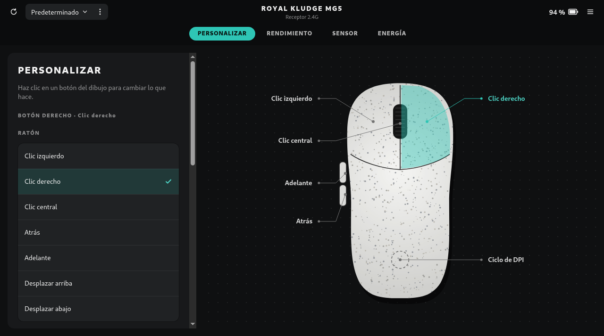
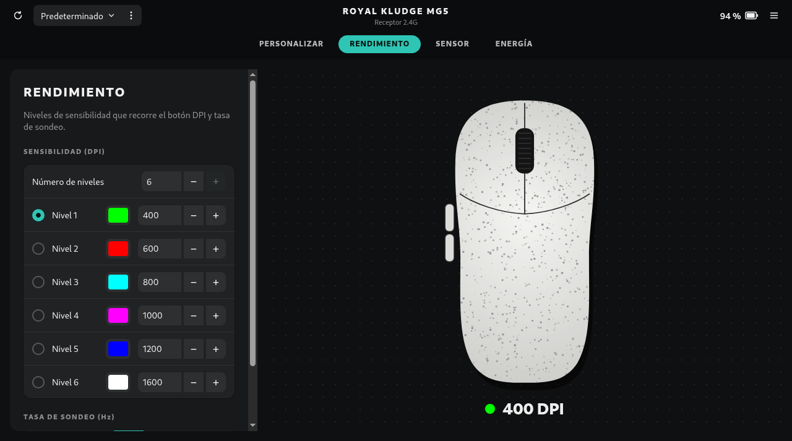

# Open RK MG5 Web

Panel de control en el navegador para el ratón **Royal Kludge MG5**, usando [WebHID](https://developer.mozilla.org/docs/Web/API/WebHID_API).
Es la versión web de [Open RK MG5 Control Panel](https://github.com/blzkz/open-rk-mg5-control-panel) (la app de escritorio para Linux)
y hace lo mismo sin instalar nada: DPI por niveles, colores, frecuencia de sondeo, LOD, debounce, modo del sensor,
Motion Sync, Ripple Control, corrección de ángulo, modo cristal, reposo, reasignación de los seis botones y perfiles.

Funciona con el receptor 2.4G (`372e:103f`) y, en principio, por cable (`372e:1073`, aún sin probar).
El protocolo está documentado en [docs/PROTOCOL.md](docs/PROTOCOL.md).




## Navegadores

WebHID solo existe en navegadores basados en Chromium de escritorio: Chrome, Edge, Opera, Brave, Vivaldi…
Firefox y Safari no lo soportan, y tampoco los navegadores de móvil. La página tiene que servirse por `https://`
o desde `localhost`.

## Uso

1. Abre la página y pulsa **Conectar ratón**.
2. Elige «RK MG5» en la lista del navegador.

El navegador recuerda el permiso, así que las siguientes veces se conecta solo. Los cambios se guardan en el ratón
en cuanto los haces. Si el ratón está dormido, muévelo y el panel se reconecta solo.

### Linux

El navegador abre el ratón por `/dev/hidraw`, que por defecto solo puede leer root. Hace falta la misma regla udev
que la app de escritorio:

```bash
echo 'SUBSYSTEM=="hidraw", ATTRS{idVendor}=="372e", ATTRS{idProduct}=="103f|1073", TAG+="uaccess"' | sudo tee /etc/udev/rules.d/70-rk-mg5.rules
sudo udevadm control --reload-rules && sudo udevadm trigger
```

Después desconecta y vuelve a conectar el receptor. Si ya tienes instalada la app de escritorio, la regla ya está puesta.

### Perfiles

Un perfil guarda todo lo que el ratón almacena: botones, niveles y colores de DPI, sondeo, LOD, debounce,
modo del sensor, interruptores y reposo. El selector de la barra superior cambia de perfil y el menú `⋮`
crea, duplica, renombra, elimina, importa o exporta perfiles. Los cambios que hagas se guardan en el perfil activo.

Los perfiles viven en el almacenamiento local del navegador. Los archivos exportados tienen el mismo formato JSON
que los de la app de escritorio (`~/.config/open-rk-mg5/profiles/`), así que puedes pasarlos de una a otra.

## Publicarlo

Se puede publicar en GitHub Pages, en cualquier hosting estático o con Docker. Los pasos están en
[docs/PUBLICAR.md](docs/PUBLICAR.md). Con Docker, en local:

```bash
docker compose up -d --build
```

y abre <http://localhost:8080>.

## Desarrollo

Es HTML, CSS y JavaScript (módulos ES) sin dependencias ni paso de compilación. Para probarlo en local:

```bash
python3 -m http.server 8000
```

y abre <http://localhost:8000>. Las pruebas del protocolo se ejecutan con Node 20 o superior:

```bash
node --test tests/
```

| Archivo | Qué hace |
|---|---|
| `js/protocol.js` | Tramas, lectura y escritura de la configuración por WebHID |
| `js/actions.js` | Acciones que se pueden asignar a los botones y captura de teclas |
| `js/mouse-view.js` | Dibujo SVG del ratón con las etiquetas de cada botón |
| `js/profiles.js` | Perfiles en `localStorage`, importar y exportar |
| `js/app.js` | Interfaz y conexión con el ratón |

## Licencia

GPL-3.0-or-later. Ver [LICENSE](LICENSE).

Royal Kludge y MG5 son marcas de sus respectivos propietarios. Este proyecto no está afiliado ni respaldado por Royal Kludge.
El protocolo HID se ha documentado a partir del configurador web oficial y de pruebas con el propio ratón, con fines de interoperabilidad.
